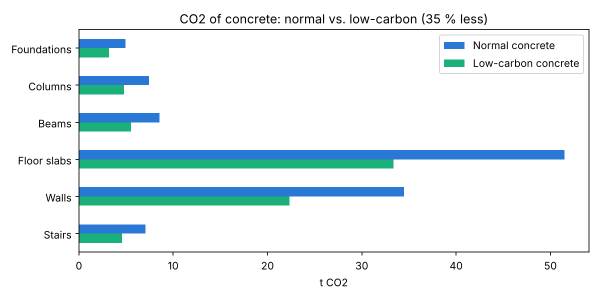

# Site & CO₂ Planner

A short Python script (about 50 lines) that takes the quantities of a concrete office building from my Revit model (TU Munich), assumed to be built with precast elements, and answers three questions for the site team:

| Question | Result |
|---|---|
| How long does the construction take? | **49 working days** |
| How many trucks deliver precast elements? | **61 trucks** |
| How much CO₂ does the concrete cause? | **114 t** with normal concrete, **74 t** with low-carbon concrete (**35 % less**) |



**Main finding:** the floor slabs are 45 % of the CO₂ and 27 of the 61 trucks. That is where low-carbon concrete helps most.

## How it works

| Result | Formula |
|---|---|
| Days | pieces ÷ pieces per day |
| Trucks | concrete m³ × 2.4 t/m³ ÷ 24 t per truck |
| CO₂ | concrete m³ × 196 kg/m³ (normal) or 127 kg/m³ (CEM III/B low-carbon) |

## Run it

```bash
git clone https://github.com/aryaa-ji/site-co2-planner.git
cd site-co2-planner
pip install -r requirements.txt
python planner.py
```

The script prints the results and creates `results.xlsx` and `co2_chart.png`.

Change a number in `quantities.csv` (for example more walls per day) and run again.

## Assumptions
- Quantities: from my Revit model. Work rates (pieces per day): my assumptions.
- CO₂ factors: normal concrete C30/37 from ÖKOBAUDAT (German building material database); low-carbon CEM III/B concrete from a published life cycle study.
- Only the concrete is counted (not steel, glass or transport). Tasks run one after another.

## Sources
- Normal concrete C30/37, 196 kg CO₂e/m³ (production, A1–A3): [ÖKOBAUDAT 2024-I via Climatiq](https://www.climatiq.io/data/emission-factor/d62c2c6e-7bda-45eb-afde-d30c3203c741)
- CEM III/B concrete, 127 kg CO₂e/m³: [comparative life cycle assessment of three concrete mixes](https://www.springerprofessional.de/a-comparative-cradle-to-gate-life-cycle-assessment-of-three-conc/7452470)

*Arya Aji – M.Sc. Civil Engineering, TU Munich*
